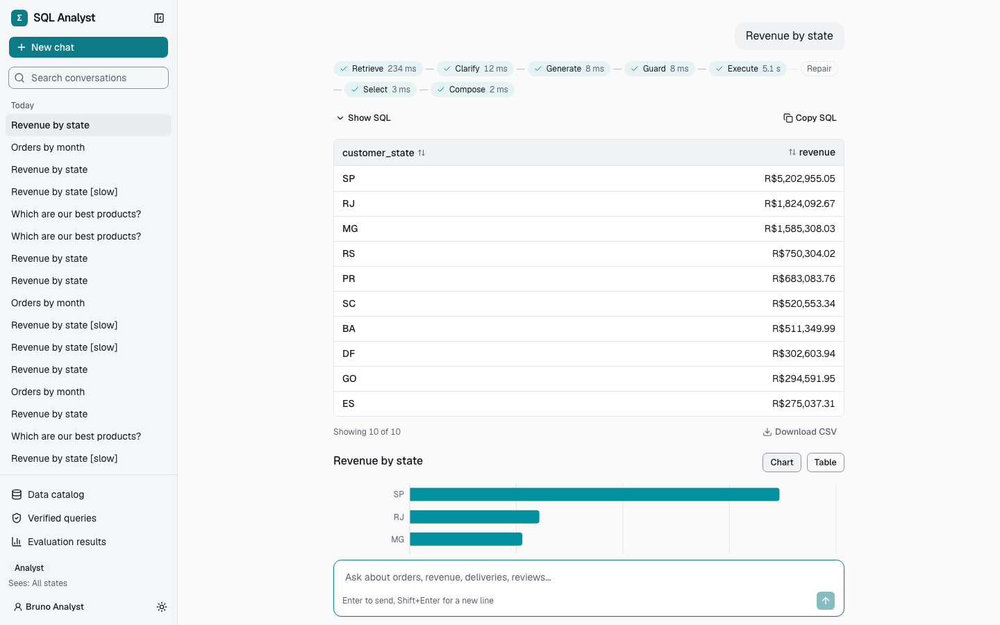
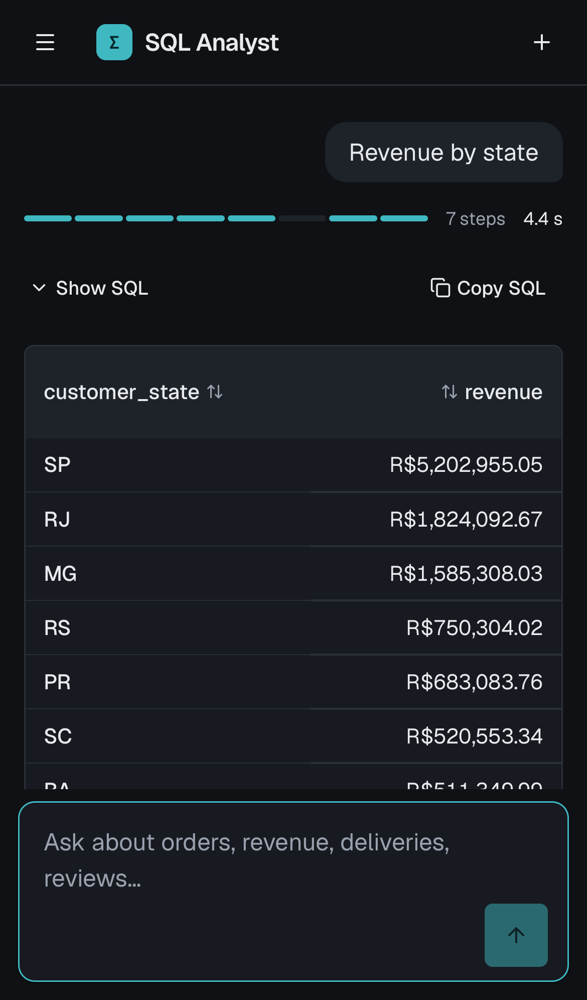
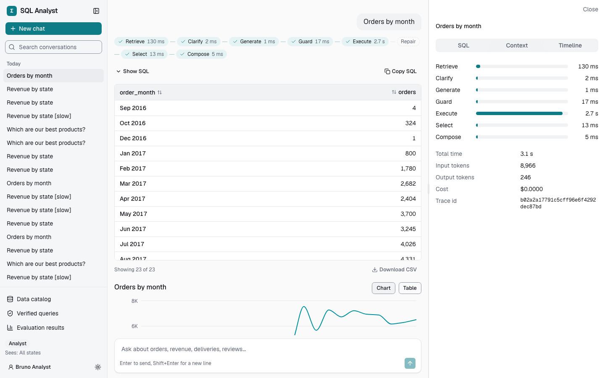
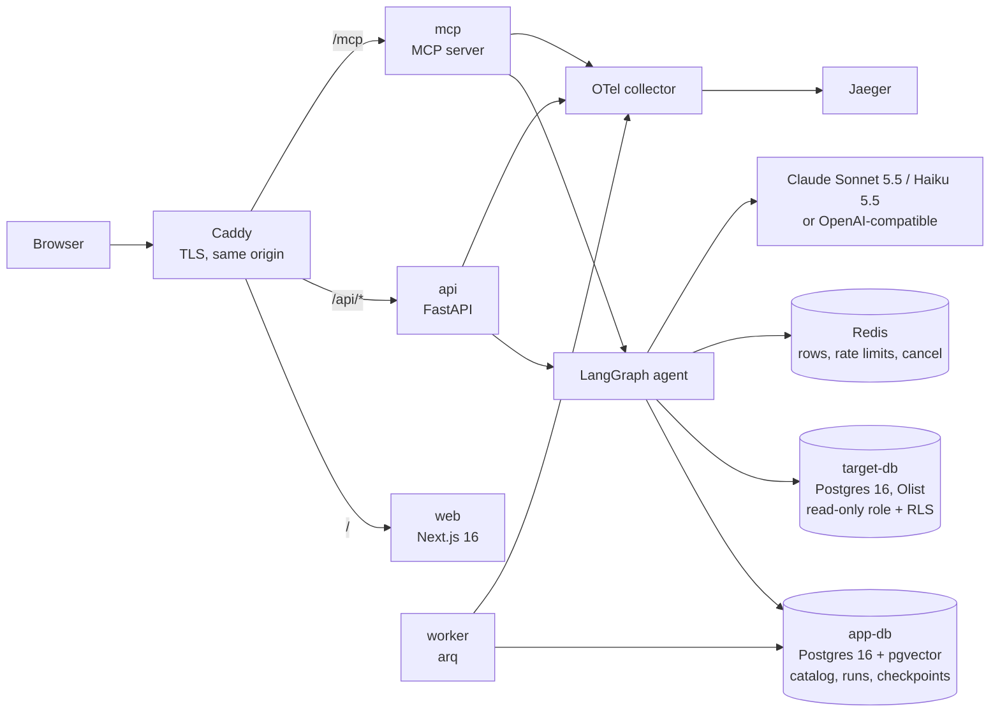
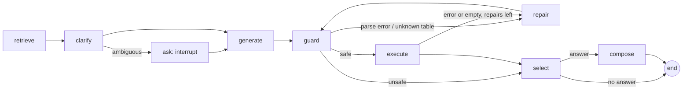

# SQL Analyst

Ask a business database a question in plain English and get the SQL, the numbers, a chart and a
short explanation, with every step the agent took on show.

The demo runs over the public [Olist Brazilian e-commerce dataset](https://www.kaggle.com/datasets/olistbr/brazilian-ecommerce)
(99,441 orders, 2016 to 2018). It is built to be left on the public internet: read-only database
role, row-level security, a parser-based SQL guard, rate limits and a daily spend cap.



<sub>Screenshots come from the end-to-end test stack: real Olist data, with the deterministic test
model writing the SQL and summary.</sub>

**Live demo:** not deployed yet (see [Deploy](#deploy)).

## What it does

- **Schema retrieval (RAG).** Vector and full-text search over table and column descriptions,
  fused with reciprocal rank fusion, picks the tables a question needs; foreign-key paths between
  them are added, and words like "Campinas" or "boleto" are matched to stored values with `pg_trgm`.
- **Clarifying questions.** "Best products" by revenue, units or rating? The run pauses
  (LangGraph `interrupt()`, Postgres checkpoints) until you answer.
- **Three candidates, checked, repaired, voted.** Three differently-instructed SQL candidates run
  in parallel. A deterministic guard allows only one read-only `SELECT` over known tables. Failing
  or empty queries go back to the model with the exact database error (up to twice). The result
  most candidates agree on wins.
- **Answer.** Result table (virtualised, sortable, CSV), a chart chosen from the result's shape,
  and a two-to-three sentence summary with caveats, streamed stage by stage over SSE.
- **Learns from feedback.** Good answers can be proposed as verified queries; once an admin
  approves them they are retrieved as worked examples for similar questions.
- **MCP server.** The same capability as read-only MCP tools (`list_tables`, `describe_table`,
  `ask`) over streamable HTTP.
- **Evals.** BIRD Mini-Dev with the official scorer and ablations, a 60-question golden Olist set,
  and a 30-case safety red team. See [EVALS.md](EVALS.md).

<table>
<tr>
<td></td>
<td></td>
</tr>
</table>

## Architecture



The agent graph:



More detail in [ARCHITECTURE.md](ARCHITECTURE.md); the threat model is in [SECURITY.md](SECURITY.md).

## Quickstart

Needs Docker, [uv](https://docs.astral.sh/uv/), Node 24 and pnpm 12.

```bash
make env                        # .env with random local secrets
# put the nine Olist CSVs in data/olist/ (see data/olist/README.md)
make up                         # caddy, web, api, worker, mcp, Postgres x2, Redis, OTel, Jaeger
make seed                       # load Olist, read-only role + RLS, demo users, catalog sync
open http://localhost:8080
```

Without an `ANTHROPIC_API_KEY`, set `FAKE_LLM=true` in `.env`: a deterministic test model writes
canned (real, runnable) SQL so you can explore the product. Set the key and `FAKE_LLM=false` for
real answers. Jaeger is on <http://localhost:16686>.

Useful targets: `make test` (backend), `make e2e` (Playwright on four devices), `make types`
(regenerate the frontend's API types), `make eval-smoke`, `make smoke` (scripted curl session).

## Design decisions

**Why pgvector, not a vector database.** The catalog is a few hundred rows that already live
next to the run history, users and checkpoints in Postgres. pgvector (HNSW) plus Postgres
full-text search plus `pg_trgm` gives hybrid retrieval with transactions and one backup.

**Why three candidates and repair.** A single LLM SQL attempt fails in predictable ways: a wrong
column, a missed join, a filter on a value spelled differently. Repair feeds back the exact
database error; voting over three independently written queries filters out one-off mistakes.
The ablations in [EVALS.md](EVALS.md) are set up to measure what each step buys and costs.
Candidate diversity comes from prompt variants, because Sonnet 5.5 doesn't accept a temperature.

**How the guard works.** `sqlglot` parses the SQL in the right dialect. It must be exactly one
statement whose root is a `SELECT` (or a set operation); every node is walked to reject writes,
DDL, `COPY`, `SET`, locking clauses and `SELECT ... INTO`; functions are checked against a
deny-list (`pg_*`, `dblink*`, `lo_*`, `current_setting`, `set_config`, `query_to_xml`, ...);
every table must be in the catalog; `LIMIT` is added or lowered. The query that runs is
**re-rendered from the validated syntax tree**, so a parser difference between sqlglot and Postgres
can't smuggle in something the guard never saw. An optional `EXPLAIN` cost ceiling blocks
runaway queries.

**Row-level security that SQL can't talk its way around.** The app connects to the data only as
`analyst_ro`, which can `SELECT` and nothing else, owns nothing, and defaults to read-only
transactions. Policies on customers, orders and every table that joins to them read the allowed
states from `app.allowed_states`, and fail closed when it is missing. The value is **HMAC-signed**
(`SP.<hmac>`), verified by a security-definer function against a key the role can't read, so even
SQL that slipped past the guard and called `set_config('app.allowed_states', '*', true)` gains
nothing. Tests run raw SQL as the role to prove this.

**Runs survive the connection.** Each run is a background task; if the stream drops, the client
shows "Reconnecting…" and polls the run until it settles. Stop aborts the stream and cancels
server-side (task cancel plus a Redis flag that other replicas check between nodes).

## Results

From runs executed in this repository (raw per-question output in `backend/evals/results/`):

| Measure | Result |
|---|---|
| BIRD Mini-Dev execution accuracy | Not run yet: needs an API key and approval of the cost estimate |
| Golden Olist set | Not run yet with a model |
| Safety red team, compromised model (always attacks) | 30 / 30 passed, 0 non-SELECT executed, 0 rows outside the SP scope |
| Safety red team, real model | Not run yet |
| Backend tests | 282 passed (guard, RLS, agent graph, API, MCP, eval harness) |
| End-to-end | 77 passed on iPhone 13, Pixel 7, iPad and 1440 px desktop, with zero serious or critical axe violations |
| Lighthouse (mobile, `/` and `/evals`) | Performance 96, Accessibility 100, Best Practices 100, SEO 100, CLS 0 |

The BIRD harness is verified with an oracle model on the real databases: it scores exactly 100%
through BIRD's official scoring code when the answers are right, and drops by exactly the
questions that are deliberately broken.

**Cost per query.** Not measured on the demo yet. Measured prompt sizes on BIRD are about 2,300 to
2,400 input tokens per SQL call; at Sonnet 5.5 prices that is about $0.005 of input per call, with
output (including thinking) the larger, still-unmeasured part. Every run records its exact
tokens and cost, shown in the Inspector.

## MCP

The MCP server listens on `/mcp` (streamable HTTP). Every request needs
`Authorization: Bearer $MCP_API_TOKEN`; queries run with the row scope of `MCP_PERSONA`.

Claude Code:

```bash
claude mcp add --transport http sql-analyst https://YOUR_HOST/mcp \
  --header "Authorization: Bearer $MCP_API_TOKEN"
```

Claude Desktop (`claude_desktop_config.json`), through `mcp-remote`:

```json
{
  "mcpServers": {
    "sql-analyst": {
      "command": "npx",
      "args": ["-y", "mcp-remote", "https://YOUR_HOST/mcp", "--header", "Authorization:${AUTH_HEADER}"],
      "env": { "AUTH_HEADER": "Bearer YOUR_MCP_API_TOKEN" }
    }
  }
}
```

MCP Inspector: `npx @modelcontextprotocol/inspector`, choose *Streamable HTTP*, enter the URL and
add the `Authorization` header. Locally the URL is `http://localhost:8080/mcp`.

## Deploy

Single host (EC2 or Lightsail) running the compose stack, with Caddy getting certificates
automatically:

1. Point a DNS record at the host and set `SITE_ADDRESS`, `SITE_URL_PUBLIC=https://...` and the
   secrets in `/opt/sql-analyst/.env` (`make env` on the host generates them).
2. Tag a release: `.github/workflows/deploy.yml` builds both images to GHCR and runs
   `docker compose -f docker-compose.yml -f docker-compose.prod.yml up -d` over SSH
   (secrets `DEPLOY_HOST`, `DEPLOY_USER`, `DEPLOY_SSH_KEY`; variable `SITE_ADDRESS`).
3. Nightly backup of the app database to S3: install `infra/deploy/sql-analyst-backup.{service,timer}`
   and set `BACKUP_S3_URI`.

In production only Caddy is reachable; reach Jaeger with `ssh -L 16686:localhost:16686`.

## Limitations

- One target database; no connecting your own data in the public demo (by design).
- Answers are only as good as the catalog: undocumented columns get LLM-drafted descriptions,
  which an admin should review.
- The chained row-level-security policies cost time on large joins (about 0.8 s instead of 0.1 s
  for a three-table aggregation over all orders). Fine at this size; a denormalised state column
  would remove it.
- Clarification is off in benchmark and MCP runs: nobody is there to answer.
- BIRD has documented annotation errors; see the failure audit in [EVALS.md](EVALS.md).

## Data and licences

- Olist dataset: Brazilian E-Commerce Public Dataset by Olist, CC BY-NC-SA 4.0. Used here for a
  non-commercial portfolio project; not redistributed.
- BIRD Mini-Dev: Li et al., NeurIPS 2023, CC BY-SA 4.0. The official evaluation scripts and a
  20-question smoke subset are included unmodified under that licence.
